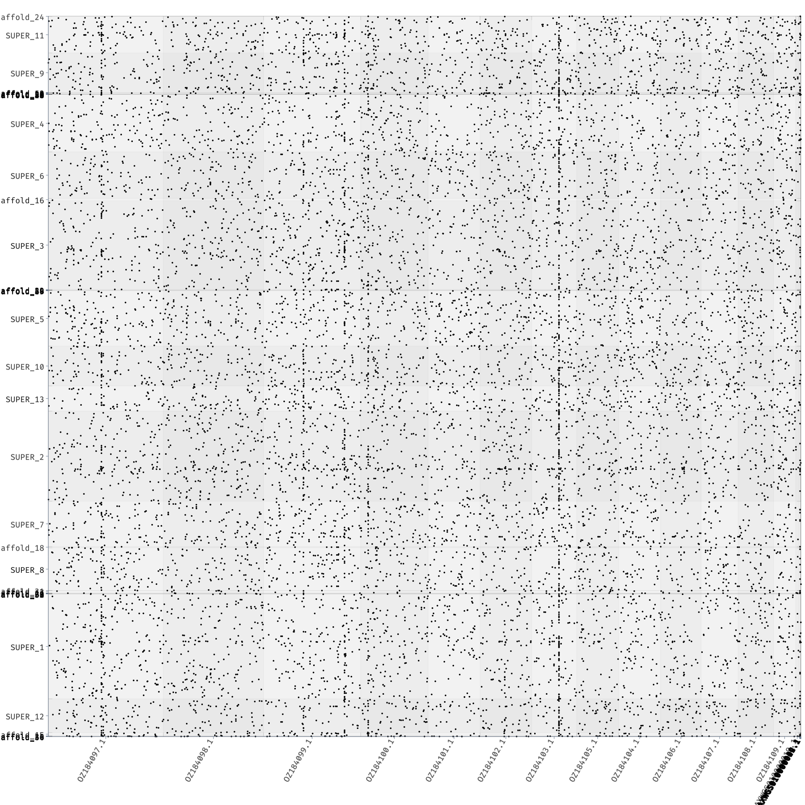
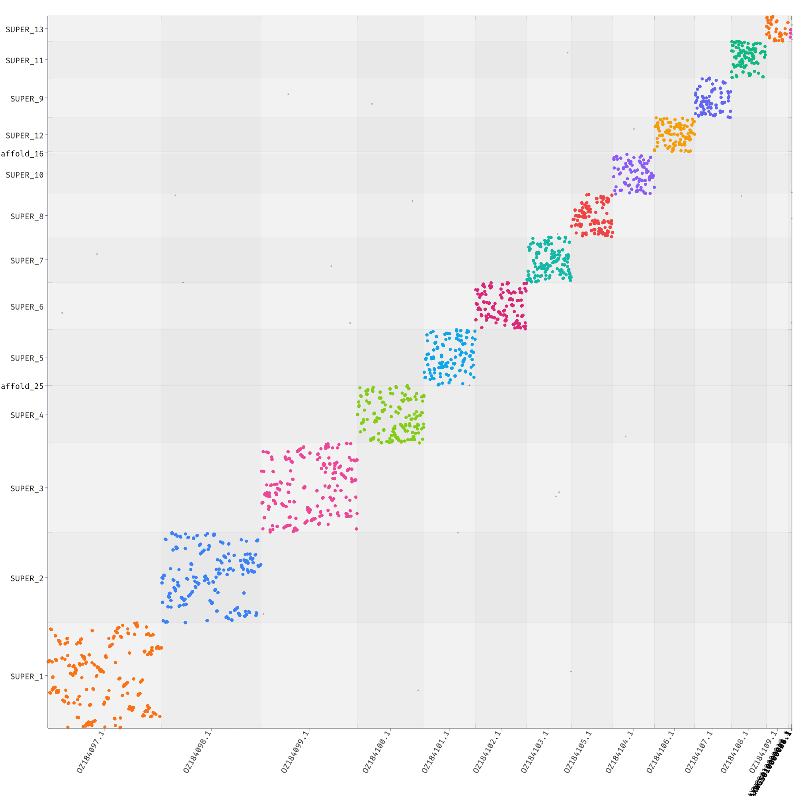

# Hobrac - Homology-based reference genome acquisition and comparison

**Preprint:** [Hobrac: a reference-guided workflow for genome comparison and synteny visualization](https://www.biorxiv.org/content/10.64898/2026.07.17.739168v2) (bioRxiv).

The purpose of Hobrac is to facilitate structural comparison between two genomes. Direct genome-to-genome alignments are sometimes too noisy to easily analyze so conserved busco genes are used instead. Here are the major steps conducted in Hobrac:
  - the user provides a genome assembly fasta file, a taxid and the organism name
  - the lineage of the organism is retrieved thanks to Taxonkit
  - Hobrac downloads the MASH database corresponding to the phylum of the assembly (we pre-computed a database per phylum and are making it available [here](https://www.genoscope.cns.fr/lbgb/mash/))
  - MASH is ran on all genomes of the selected phylum to determine which one is the closest to the provided assembly
  - Hobrac chooses the closest Busco dataset to use (based on taxonomy) and Busco is ran on the closest reference genome (based on the MASH distance) and on the assembly. A PAF file containing the positions of the Busco genes on the reference and on the assembly is created
  - Minimap2 is launched to align the closest reference (based on the MASH distance) and the assembly
  - Dotplots from the genome-to-genome alignment and the busco positions are generated. For convenience, an alignment viewer is available [here](https://www.genoscope.cns.fr/lbgb/hobrac/)


On the left is the genome-to-genome alignment of Felimare picta (y-axis) vs Phyllidia flava (x-axis) and on the right the alignment of BUSCO genes for the same genomes.

|  |  |
| ------- | ------- |
|  |  |


## Installation

### Install Hobrac

The Hobrac launcher runs on the host and requires Python **>= 3.11**, even when workflow tools run in containers.

```
git clone https://github.com/Genoscope-LBGB/hobrac
cd hobrac
pip install .
```

### Using Containers

#### Taxonkit Database

Before running either container example, download the Taxonkit taxonomy database from [NCBI](https://ftp.ncbi.nih.gov/pub/taxonomy/taxdump.tar.gz), extract it, and set the `TAXONKIT_DB` environment variable to point to the directory containing the extracted files:

```
export TAXONKIT_DB=/path/to/taxonkit_db
```


#### With Singularity/Apptainer (recommended for HPC)

```
hobrac -a scaffolds.fa -n 'Lepadogaster purpurea' -t 164309 -o hobrac_lepadogaster_purpurea --use-apptainer
```

#### With Docker

```
hobrac -a scaffolds.fa -n 'Lepadogaster purpurea' -t 164309 -o hobrac_lepadogaster_purpurea --use-docker
```

### Manual Dependency Installation

If you are not using containers, install the following workflow tools and ensure they are available on your `PATH`:

  - [Taxonkit](https://github.com/shenwei356/taxonkit)
  - [NCBI datasets](https://github.com/ncbi/datasets) 
  - [MASH](https://github.com/marbl/Mash)
  - [BUSCO](https://gitlab.com/ezlab/busco) **>= 6.1.0**
  - [Minimap2](https://github.com/lh3/minimap2)
  - [dotplotrs](https://github.com/Genoscope-LBGB/dotplotrs)

## Usage 

Hobrac only needs three mandatory parameters:
  - `-a`: path to a genome assembly fasta file
  - `-n`: the scientific name of the organism between quotes
  - `-t`: the taxid of the organism

The `-o` argument is optional and is used to indicate the path to an output folder that will be created by Hobrac.

A typical Hobrac command looks like this:
```
hobrac -a scaffolds.fa -n 'Lepadogaster purpurea' -t 164309 -o hobrac_lepadogaster_purpurea
```

By default, Hobrac runs computations on the machine it is launched, but being a Snakemake pipeline wrapper it can also submit jobs to a computing grid. Hobrac is packaged with `snakemake-executor-plugin-slurm` which makes it possible to use a SLURM computing grid, it is the responsibility of the user to install the correct plugin for their computing grid. To launch jobs on a computing grid, you can use the `-e` flag with the correct plugin. As an example, this command will launch Hobrac jobs on a slurm grid:
```
hobrac -a scaffolds.fa -n 'Lepadogaster purpurea' -t 164309 -o hobrac_lepadogaster_purpurea -e slurm
``` 


The list of available plugins is available [here](https://snakemake.github.io/snakemake-plugin-catalog/).

## Manual Reference

By default, Hobrac selects the closest reference genome automatically via MASH. However, it is possible to provide one or more reference genomes manually using the `-r` flag, which disables the reference searching step entirely.

```
hobrac -a scaffolds.fa -n 'Lepadogaster purpurea' -t 164309 -r my_reference.fa
```

Multiple references can be specified by repeating the flag:

```
hobrac -a scaffolds.fa -n 'Lepadogaster purpurea' -t 164309 -r reference_1.fa -r reference_2.fa
```

Automatically downloaded references have their sequences renamed to `chr<name>` using the NCBI assembly report. For each manual reference without supplied BUSCO results, Hobrac instead makes a pass over each FASTA header and renames the sequence to a `chr<token>` name when it recognizes one. Two header styles are handled: a literal `chr<token>` (e.g. `chr1`, `chrX`, `chr2L`, `chrMT`) and the descriptive GenBank/ENA form (e.g. `... chromosome 1, whole genome shotgun sequence` or `... chromosome: 4`), which is normalized to `chr1`, `chr4`, etc. For every manual reference, a `reference/<name>.chr_rename.tsv` mapping file (`old_name<TAB>new_name`, one row per sequence) is written so the renaming stays traceable. Headers without a recognizable chromosome are left unchanged.

Unless `--busco-assembly` is supplied, the assembly gets the same pass so its chromosomes appear with pretty names in the karyotype and dotplots, with the mapping written to `assembly/<name>.chr_rename.tsv`. Draft assemblies whose contigs/scaffolds carry no recognizable chromosome name are left untouched.

## Pre-computed BUSCO Results

BUSCO is among the most time-consuming steps of the pipeline. If BUSCO was already computed for the assembly or the reference, the results can be reused with the `--busco-assembly` and `--busco-reference` flags. Each flag accepts a path to a BUSCO result directory, a `run_*` subdirectory, or a `full_table.tsv` file directly.

`--busco-reference` requires manual references supplied with `-r`/`--reference` and can be repeated. The first BUSCO input applies to the first `-r`, the second to the second `-r`, and so on; Hobrac does not infer pairings from filenames or accessions. If fewer BUSCO inputs are supplied than references, BUSCO runs for the remaining references. Put references with precomputed results first in the `-r` list. Automatic reference selection and excess `--busco-reference` inputs are rejected. `--busco-assembly` remains independent and can be used with either reference selection mode.

Reusing BUSCO results disables sequence renaming independently for each corresponding input: `--busco-assembly` preserves assembly IDs, and each `--busco-reference` preserves its paired manual reference's IDs. Inputs without precomputed BUSCO results keep the usual chromosome renaming. The sequence IDs in each supplied BUSCO table must already match the corresponding original FASTA.

```
hobrac -a scaffolds.fa -n 'Lepadogaster purpurea' -t 164309 \
    -r reference_1.fa -r reference_2.fa -r reference_3.fa \
    --busco-assembly /path/to/busco_assembly \
    --busco-reference /path/to/busco_reference_1 \
    --busco-reference /path/to/busco_reference_2
```

This reuses BUSCO results for the assembly, `reference_1.fa`, and `reference_2.fa`, and runs BUSCO only for `reference_3.fa`.

## Multi-Reference Selection

By default, Hobrac compares your assembly to the single closest reference genome found via MASH. You can choose to compare against multiple reference genomes using the `--ref-count` flag. This will identify the top N closest genomes and run the full analysis pipeline (Alignments, BUSCO) against each of them in parallel.

```
# Compare against the top 3 closest reference genomes
hobrac -a scaffolds.fa -n 'Lepadogaster purpurea' -t 164309 --ref-count 3
```


## Skip Genomic Alignment

The genome-to-genome alignment (Minimap2) can be the most time-consuming part of the pipeline and its dotplots are sometimes too noisy to be useful. The `--skip-genomic` flag disables this step entirely, so only the BUSCO side runs (BUSCO, the JCVI karyotype, and the ALG-colored dotplots, which are derived from BUSCO gene positions rather than from the Minimap2 alignment).

```
hobrac -a scaffolds.fa -n 'Lepadogaster purpurea' -t 164309 --skip-genomic
```


## JCVI Karyotype Visualization

In addition to dotplots, Hobrac can produce JCVI karyotype plots that display synteny relationships between chromosomes. Shared BUSCO genes are drawn as colored links between the assembly and each reference genome, which makes it possible to identify large-scale rearrangements at a glance. A karyotype PNG is generated automatically as part of the pipeline output.

### ALG Coloring

By default, links are colored uniformly. To color genes according to Ancestral Linkage Groups (ALGs), four options are available:

```
# Use the pre-computed 29-metazoan-ALG color scheme
hobrac -a scaffolds.fa -n 'Lepadogaster purpurea' -t 164309 --color-metazoan-alg

# Use the pre-computed 24-bilaterian-ALG color scheme
hobrac -a scaffolds.fa -n 'Lepadogaster purpurea' -t 164309 --color-bilaterian-alg

# Use the pre-computed 20-Spiralian-ALG color scheme
hobrac -a scaffolds.fa -n 'Lepadogaster purpurea' -t 164309 --color-spiralian-alg

# Use a custom color file
hobrac -a scaffolds.fa -n 'Lepadogaster purpurea' -t 164309 --custom-colors colors.tsv
```

Pre-computed color schemes are available for the following BUSCO datasets: actinopterygii, anthozoa, arthropoda, cnidaria, crustacea, lophotrochozoa, metazoa, mollusca and vertebrata. If the BUSCO dataset selected by the pipeline is not part of this set, Hobrac falls back to default coloring.

The custom color file is a tab-separated file with three columns: a BUSCO gene ID, a color (as `R,G,B`, `#RRGGBB`, or `RRGGBB`), and an ALG name. As an example:

```
3189364at33208	#e54656	J2
4255818at33208	#a3757d	F
4283313at33208	#aa7e27	Ea
```

When using custom colors, ALG detection still runs by default. A plotted link receives its gene's custom color only when the gene's selected display chain contains both assemblies. Genes absent from the color mapping, genes with no compatible chain, and links outside the selected display chain are shown in grey. This is a chain-membership check, not another pairwise significance test. With `--skip-alg` and a nonempty custom-color mapping, detection and chain-membership filtering are bypassed: every listed gene receives its custom color on every plotted pair where it is present.

### ALG Detection Parameters

Hobrac detects significant chromosome associations using Fisher's exact test with Bonferroni correction. The following parameters control this behavior:

  - `--alg-pvalue`: base significance threshold (default: 0.01)
  - `--min-chain-genes`: minimum distinct genes with observed-path support for a chromosome chain (default: 5). A gene may support multiple alternative chains; missing assemblies do not contribute support.
  - `--permissive-alg`: relax chain validation so that each node only needs one significant link instead of `floor(n/2)`.
  - `--hide-non-significant`: hide links that would otherwise be light grey.


### Ambiguous Chains and Display Colors

For each single-copy BUSCO gene present in at least two assemblies, Hobrac builds the graph of significant associations between its observed chromosomes. Every distinct longest-path chromosome set in each connected component receives one vote from the gene. Different traversal orders of the same chromosome set do not add votes. Chains below the support threshold are removed before strict subsets of longer chains are pruned.

Chain validation iteratively removes chromosomes with too few significant links. Surviving groups are reconstructed from their actual significant links, not from an arbitrary traversal order. When candidates produce the same validated chain, their supporting gene IDs are unioned so shared genes are counted only once. Inferred chromosome sets and their support are independent of assembly/chromosome names and input order, after accounting for renamed identifiers. If exact path enumeration exceeds its search bound, Hobrac stops rather than exporting incomplete, name-dependent support.

Display assignment is separate from support. A gene is compatible with a surviving chain when its chromosome matches at every shared assembly; missing assemblies are tolerated for compatibility only. All compatible chains are retained in the per-gene output. One is selected for display using, in order:

1. Highest observed-path gene support, frozen before any display assignments.
2. Most links that can actually be drawn for this gene between consecutive assemblies in the JCVI layout.
3. Lowest chain ID in deterministic sorted order.

Assignments never increment support. The second and third criteria may change the display choice when the layout or names change, but do not change detected chromosome sets or support counts. For equal-support chains ABC and ABD in an A–B–C–D layout, a gene observed in all four assemblies is displayed using ABC: A–B and B–C receive its color, while C–D remains grey. Compatible alternatives are not combined into an artificial ABCD chain.

The tables in `synteny_plots/` distinguish biological support from display choices:

- **`algs.tsv`**: `chain_id`, `color`, `n_genes`, followed by one chromosome column per assembly. `n_genes` is observed-path support, including shared genes, not the number finally displayed with that chain. Its sum can exceed the number of distinct genes. Custom-color runs write `-` for the chain color because custom colors belong to individual genes.
- **`gene_chains.tsv`**: `chain_ids`, `custom_alg_id`, `gene`, `color`, `display_chain_id`, followed by assembly chromosome columns and `<assembly>_pos` coordinate columns. `chain_ids` contains every compatible surviving chain ID, comma-separated, or `-`; `display_chain_id` records the single plotting choice, or `-`. `custom_alg_id` remains the external ALG annotation from the custom-color file. The `color` column is the gene's global identity color; individual JCVI links outside its display chain are still grey.

This replaces the former scalar `chain_id` column in `gene_chains.tsv`; downstream consumers should use `chain_ids` for alternatives and `display_chain_id` for visualization. Gene and color remain columns 3 and 4 for dotplot extraction. The legend uses the display chain (or the external custom ALG label), never a comma-separated membership list as a new ALG.

A gene observed on A1, B2 and C3 but absent from D may list both ABC and ABD as compatible chains, while contributing observed-path support only to ABC. Therefore `algs.tsv` support counts need not equal the number of rows listing a chain in `gene_chains.tsv`.

### Other Synteny Options

  - `--min-busco-genes`: minimum number of complete BUSCO genes required per sequence for a chromosome to appear in the plot (default: 30)
  - `--names`: comma-separated custom names for the tracks in the plot. If one name is provided, it applies to the assembly only. If multiple names are provided, the count must equal 1 (assembly) + number of references.

## Output

If everything went as expected, the output directory should contain the following structure:

```
hobrac_analysis/
├── mash/
│   ├── mash.dist                    # MASH distances between the assembly and all genomes
│   └── selected_accessions.txt      # Accession IDs of the selected reference(s)
├── reference/
│   └── <accession>.fna              # Downloaded reference genome(s)
├── busco/
│   ├── busco_assembly/              # BUSCO results for the assembly
│   ├── busco_reference_<accession>/ # BUSCO results for each reference
│   └── chosen_dataset.txt           # BUSCO dataset that was selected
├── aln/
│   ├── vs_<accession>/
│   │   ├── aln.paf                  # Minimap2 genome-to-genome alignment
│   │   ├── dotplot.png              # Genome-to-genome dotplot (color)
│   │   ├── dotplot_bw.png           # Genome-to-genome dotplot (black & white)
│   ├── busco_<accession>/
│   │   ├── aln_busco.paf            # BUSCO-based alignment in PAF format
│   │   ├── dotplot_busco.png        # BUSCO dotplot (color)
│   │   ├── dotplot_busco_bw.png     # BUSCO dotplot (black & white)
│   ├── rank1_<Species_name>_busco -> busco_<accession>/  # Ranked symlinks (closest first)
│   └── rank1_<Species_name>_geno  -> vs_<accession>/
├── synteny_plots/
│   ├── karyotype.png                # JCVI karyotype plot
│   ├── algs.tsv                     # Chains and shared observed-path support
│   ├── gene_chains.tsv              # Compatible chains and display assignments
│   ├── dotplots/                    # Per-reference ALG dotplots
│   ├── dotplots_grid.png            # All per-reference dotplots tiled
│   └── dotplots_grid_dark.png
├── benchmarks/                      # Runtime and resource usage per step
```

When using `--ref-count`, the `aln/` directory will contain one `vs_<accession>` and one `busco_<accession>` subdirectory per reference, along with numbered symlinks (`rank1_<Species_name>_*`, `rank2_<Species_name>_*`, ...) sorted by MASH distance. The `rank<i>` prefix keeps each symlink unique even when two references belong to the same species; references without an NCBI assembly report (e.g. manual references) fall back to the accession in place of the species name.

The PAF alignment files can be loaded directly into the [online viewer](https://www.genoscope.cns.fr/lbgb/hobrac/) for interactive exploration.

## Visualization

To enable manual inspection of the alignments, a viewer is available online on our [website](https://www.genoscope.cns.fr/lbgb/hobrac/). This viewer makes it possible to explore alignments interactively using either the classical dotplot view or various ribbon plots.
