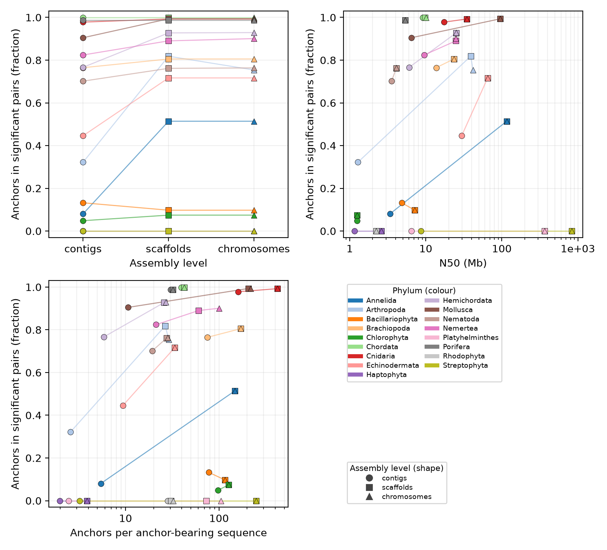
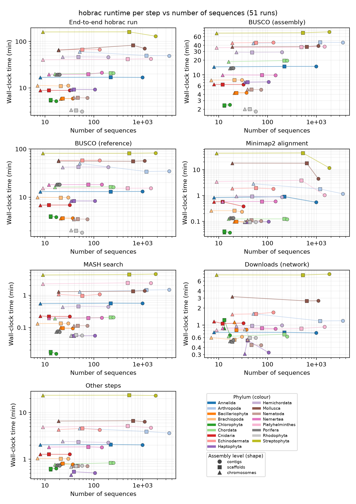

# Assembly-fragmentation experiment

Does Hobrac degrade on fragmented assemblies? For each sampled ATLASea genome, the full pipeline runs on the contigs, scaffolds and chromosomes of the same assembly.

```text
                                       ┌─ contigs ───── Hobrac ─┐
Frozen manifest ── download ── levels ─┼─ scaffolds ─── Hobrac ─┼─ report
                                       └─ chromosomes ─ Hobrac ─┘
```

## Result

Archived run: **17 genomes, 17 phyla, 51 runs**, fixed seed over the 386 ATLASea assemblies listed on 2 October 2026, MASH release 20260629, all runs successful at the first attempt. Sample: 7–3,505 sequences, 17 Mb–5.7 Gb, contig N50 1.2–30 Mb.

- **Sequence count has no measurable effect on signal or runtime.** Scaffolds match chromosomes in every genome (max Δ signal 0.06, otherwise ≤ 0.01), including six genomes with 222–1,194 unplaced scaffolds.
- **Contigs lose signal only when they carry too few anchors.** Four genomes with < 10 BUSCO anchors per contig lost signal; none with > 20 did. Short-range collinearity stays visible in grey; what is lost is the chromosome-scale assignment.
- **Four genomes have no signal at any level.** Their reference is too distant; this measures the MASH database, not fragmentation (see the [MASH reference survey](../mash_reference_survey/README.md)).
- **Runtime is BUSCO-bound.** The longest BUSCO run takes 51–95% of wall time; contigs run in 0.81–1.09× the chromosome time.
- **Limits.** Three points per genome from real assembler output, not a controlled N50 gradient; the exact N50 at which signal disappears is not located; dotplot significance is the only quantified output.



[PDF](report/signal_vs_contiguity.pdf). One point per run; y = fraction of BUSCO anchors shared with the reference that fall in a significant assembly–reference pair (the anchors Hobrac colours). Colour = phylum, shape = level, lines join the levels of one genome.



[PDF](report/runtime_vs_sequences.pdf); the same against [N50](report/runtime_vs_n50.pdf) and [cumulative length](report/runtime_vs_total_length.pdf).

## Running the workflow

Requirements: Linux, Bash, Python ≥ 3.11, Hobrac with its tools (or a container runtime), Snakemake 9 with the Slurm executor plugin, matplotlib. Network access to NCBI and the Genoscope MASH server.

```bash
python3 -m pip install 'snakemake>=9,<10' snakemake-executor-plugin-slurm 'matplotlib>=3.6'
```

Copy **this whole directory** including `scripts/` and `profiles/`, then:

```bash
cp config.example.sh config.local.sh      # 1. edit before submitting
bash submit.sh prepare                    # 2. then inspect manifest.tsv, phylum_coverage.tsv,
                                          #    atlasea_assemblies.tsv, sampling_exclusions.json
bash submit.sh workflow                   # 3. run; rerun to continue unfinished work
bash submit.sh summarize                  #    partial report at any time
bash workflow.sh config.local.sh --dry-run
```

Configuration (`config.local.sh`):

| Key | Rule |
| --- | --- |
| `WORK` | Absolute shared path, no spaces or shell metacharacters. **A new seed, BioProject or MASH release needs a new `WORK`.** |
| `CPUS`, `MEMORY`, `TIME` | Per-run Slurm allocation. Both BUSCO steps request 12 threads, so 24 CPUs lets them run concurrently. |
| `EXTRA_SBATCH` | Add a node constraint: runtimes are comparable only on one node type. |
| `MAX_CONCURRENT` | Child jobs submitted at once. |
| `MASTER_TIME` | Must cover the slowest Hobrac run plus queueing. |
| `HOBRAC_ARGS` | Extra options applied to every run. Rejected: input, output, reference, executor, MASH release, precomputed BUSCO, `--stop-after-mash`, `--skip-genomic`, `--ref-count`. |
| `CLEANUP` | `true` (default) deletes downloaded and level FASTAs once their runs succeed. |

Rules:

- A successful run is never recomputed; delete `runs/<accession>/<level>/` to force a rerun.
- A failed run restarts from scratch; `attempt` in `runs.tsv` counts tries, so every runtime is one uninterrupted execution.
- Never run two controllers against the same `WORK`.

### Local executor

To run every job serially on one node (e.g. inside one allocation):

```bash
#!/bin/bash
#SBATCH --nodes=1 --exclusive --cpus-per-task=24 --mem=160G --time=2-00:00:00
bash /path/to/assembly_fragmentation/workflow.sh config.local.sh --executor local
```

- `--cpus-per-task` must equal `CPUS`; Hobrac uses every CPU in its affinity mask and `runs.tsv` records that as `cpus`.
- Uses `profiles/local` with `--cores CPUS`: one Hobrac run at a time (`rule hobrac` declares `threads: CPUS`); `MAX_CONCURRENT` does not apply. `--cores 2×CPUS` runs two, but each still sees every CPU.
- Never pass `--jobs`: Snakemake stops restricting cores once a node limit is set.
- Expect about one day for the default 51 runs on a current Xeon node.

## Outputs

Written to `$WORK/report/`. The archived `report/` here is the output of `summarize` for the run above; it is a **report archive**, not a work directory (no manifest, taxdump, genomes, level FASTAs or run directories). Its signal and runtime figures were regenerated from `runs.tsv` with a revised layout; `script_sha256` in `summary.json` identifies the script of the original run.

| File | Content |
| --- | --- |
| `runs.tsv` | One row per genome × level: status, attempt, sequences, cumulative length, N50, selected reference and MASH distance, BUSCO lineage and C/S/D/F/M, anchors and anchor-bearing sequences, share of anchors in significant pairs, end-to-end and per-step-group wall times, node, CPU model, CPU count. |
| `benchmarks.tsv` | Every Hobrac Snakemake benchmark: wall time, CPU time, max RSS. |
| `reference_selection.tsv` | Reference and distance per level; `same_reference` = `yes`, `no` or `incomplete`. |
| `runtime_vs_{n50,total_length,sequences}.*` | Runtime per step group against each variable, log–log; lines join the levels of one genome. |
| `signal_vs_contiguity.*` | Share of anchors in significant pairs against level, N50 and anchors per anchor-bearing sequence. |
| `dotplot_grid_busco.pdf`, `dotplot_grid_busco_bw.pdf`, `dotplot_grids/` | Hobrac's BUSCO dotplots (`aln/busco_<reference>/dotplot_busco*.png`), one genome per row, levels as columns; pages also as PNG. |
| `summary.json` | Status counts, reference agreement, provenance hashes. |

Runtime panels and the Hobrac rules they aggregate:

| Panel | Rules | Note |
| --- | --- | --- |
| End-to-end Hobrac run | the whole `hobrac` command | Excludes queueing. |
| BUSCO (assembly) | `busco_assembly` | |
| BUSCO (reference) | `busco_reference_*` | Identical input across levels when `same_reference = yes`; their spread is cluster timing noise. |
| Minimap2 alignment | `aln_*` | |
| MASH search | `mash`, `select_references` | |
| Downloads | `download_db`, `get_reference_*`, `get_busco_dataset`, `download_busco_dataset` | Network-bound, independent of the assembly. |
| Other steps | all remaining rules | |

Dotplot colours: dotplotrs colours an assembly–reference sequence pair only when its Fisher test, Bonferroni-corrected over assembly × reference sequences, is significant. Other anchors are grey; sequences without a complete BUSCO shared with the reference are not drawn.

## Design

**Genome set.** Preparation downloads the NCBI Datasets reports of every assembly in the ATLASea umbrella BioProject `PRJEB64126` into `atlasea_assemblies.tsv` with phylum (from a frozen NCBI taxdump, reused by Hobrac's taxonkit) and eligibility. Excluded: RefSeq copies (`GCF_`), alternate haplotypes, non-current, below chromosome level; taxid missing from the taxdump or lineage without phylum/species rank; phylum without a sketch in the frozen MASH release; duplicate species (representative chosen by assembly level, then reference status, then newest release, then accession). One species per phylum is drawn with a fixed seed from accession-sorted pools.

**Assembly levels**, built from the NCBI FASTA and its sequence report; `levels.json` records sequences, cumulative length, N50, remaining Ns and NCBI's own contig count:

| Level | Sequences | Names |
| --- | --- | --- |
| `chromosomes` | Assembled molecules | `chr<name>` |
| `scaffolds` | Chromosomes + unlocalized and unplaced scaffolds | GenBank accessions for non-chromosomes |
| `contigs` | Every scaffold-level sequence split at runs of ≥ 10 Ns | `<name>_ctg<i>` when split |

**Hobrac runs.** Each genome × level runs the default pipeline inside one shared Slurm allocation, so end-to-end time excludes queueing: MASH reference selection, BUSCO on assembly and reference, minimap2, plots.

```text
hobrac -a <level>.fna.gz -n <name> -t <taxid> -o runs/<accession>/<level>/hobrac \
    --mash-db-version <frozen release> -e local [--use-<container>] [HOBRAC_ARGS]
```

The reference is not fixed, but the MASH release is resolved once during preparation, so a reference change between levels comes from the assembly alone.

## Detailed results

### Signal

Scaffolds vs chromosomes: largest difference 0.06 in *Acanthonyx lunulatus*, the only genome whose chromosome level selected a different reference; all others ≤ 0.01. Unplaced scaffolds are short, carry few anchors, and neither add nor remove signal.

Contigs vs chromosomes: 13 genomes change by < 0.10. The four that lose more all have < 10 anchors per anchor-bearing contig:

| Genome | Contigs | Contig N50 | Anchors per anchor-bearing contig | Signal, contigs → scaffolds → chromosomes |
| --- | ---: | ---: | ---: | --- |
| *Ophelia neglecta* (Annelida) | 996 | 3.4 Mb | 5.4 | 0.08 → 0.51 → 0.51 |
| *Acanthonyx lunulatus* (Arthropoda) | 3,505 | 1.3 Mb | 2.6 | 0.32 → 0.82 → 0.75 |
| *Opheodesoma grisea* (Echinodermata) | 131 | 29.7 Mb | 9.4 | 0.45 → 0.72 → 0.72 |
| *Glandiceps talaboti* (Hemichordata) | 198 | 6.1 Mb | 5.9 | 0.77 → 0.93 → 0.93 |

This is the expected behaviour of the test: a pair is coloured only if a sequence holds enough anchors from one reference chromosome to survive Bonferroni correction over every assembly × reference pair. The relevant quantity is shared BUSCO genes per sequence — N50 relative to the lineage's marker density — not N50 alone.

No significant pair at any level, chromosomes included:

| Genome | Reference | MASH distance | Anchors | Likely cause |
| --- | --- | ---: | ---: | --- |
| *Rebecca billardiae* (Haptophyta) | *Prymnesium parvum* GCA_041296205.1 | 0.233 | 97 | Too few anchors (`eukaryota` lineage, 129 markers) |
| *Pseudobiceros splendidus* (Platyhelminthes) | *Schmidtea mediterranea* GCA_045838265.1 | 0.238 | 944 | Polyclad vs triclad; extensively rearranged reference |
| *Dudresnaya verticillata* (Rhodophyta) | *Pyropia yezoensis* GCA_009829735.1 | 0.291 | 1,072 | Florideophyceae vs Bangiophyceae |
| *Halophila stipulacea* (Streptophyta) | *Allium cepa* GCA_030765085.1 | 0.195 | 2,251 | Alismatales vs Asparagales; polyploid history, 16 Gb reference |

MASH distance alone does not predict this: *Ophelia neglecta* and *Pseudobiceros splendidus* both sit at 0.238 and only the former works. These rows are kept in all figures and tables.

### Reference selection

Same reference at all three levels in 16 of 17 genomes (`reference_selection.tsv`). *Acanthonyx lunulatus* chromosomes selected GCA_054960195.1 over GCA_023348025.1 at MASH 0.1613 vs 0.1610: removing the unplaced scaffolds swapped two equally close references; signal was similar with both.

### Runtime and memory

24 CPUs, one node type.

| Measure | Value |
| --- | ---: |
| End-to-end wall time | 3.1 min (*Dudresnaya verticillata*, 76 Mb) – 161 min (*Halophila stipulacea*, 5.7 Gb) |
| Contigs / chromosomes time | 0.81–1.09× |
| Scaffolds / chromosomes time | 0.83–1.28× (outliers: reference change in *A. lunulatus*, one slow *Striarca lactea* scaffold run) |
| Longest BUSCO run (assembly or reference, concurrent) | 51–95% of wall time; depends on genome size and lineage |
| Minimap2 | ≤ 28% of a run |
| Peak memory (max RSS over all rules) | 2.1–130 GB, set by BUSCO on the larger genome (extreme: 16 Gb *Allium cepa* reference) |
| Contigs / chromosomes memory | 0.65–1.20× |

Minimap2 was *faster* on contigs than on chromosomes for the largest genomes: *Halophila stipulacea* 12 vs 44 min, *Striarca lactea* 4.5 vs 18 min, *Pseudobiceros splendidus* 1.0 vs 3.5 min.

## Directory layout

| Path | Purpose |
| --- | --- |
| `config.example.sh` | Template configuration |
| `submit.sh` | Submits preparation, controller or reporting jobs to Slurm |
| `workflow.sh`, `Snakefile` | Launches the Snakemake controller; defines the DAG |
| `profiles/` | `slurm` for the default controller, `local` for `--executor local` |
| `scripts/` | Python backend and Slurm job entry point |
| `tests/` | Offline unit tests: `python3 -m unittest discover -s tests -t .. -v` |
| `report/` | Archived tables, figures and dotplot grids of the run above |
