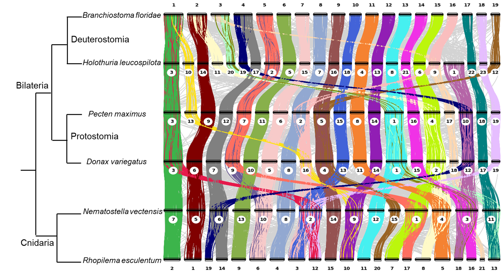
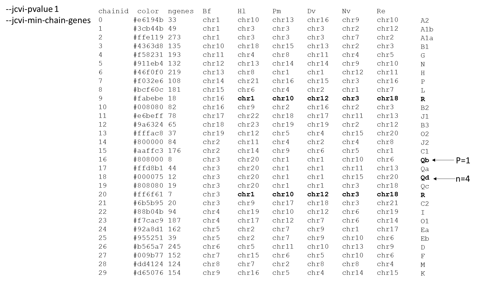
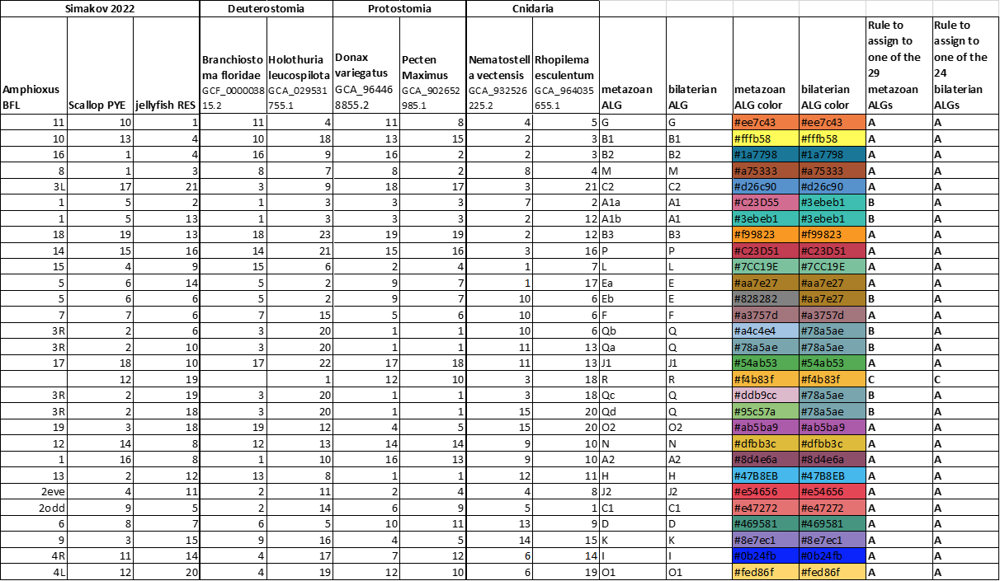
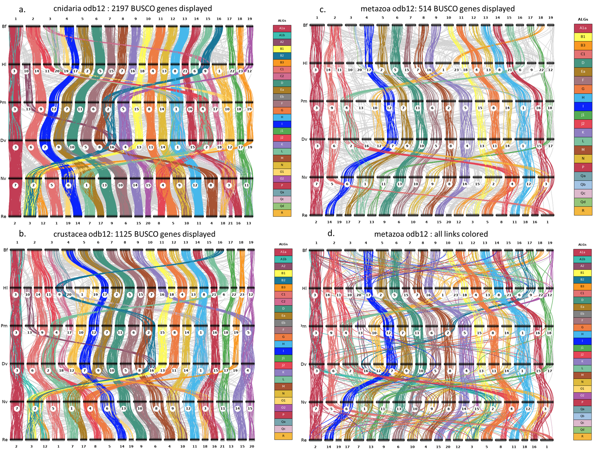

# Mapping known ALGs on BUSCO datasets

Color files corresponding to the Ancestral Linkage Groups (ALGs) defined by
Simakov *et al.* (2022) were generated for various odb12 datasets using the
following procedure.

We first used HoBRAC to build synteny ribbon-plots between 6 genome assemblies:
*Donax variegatus* plus 5 genomes commonly used for ancestral linkage group
reconstruction (Simakov *et al.*, 2022; Lewin, Liao & Luo, 2025). HoBRAC was run using the taxid corresponding to *Pecten maximus* (`-t 6579`) so that the BUSCO *mollusca* odb12 dataset would be used, with the following options:

```
--min-BUSCO-genes 10 --alg-pvalue 0.05 --permissive-alg
```

27 ALGs were detected (Table 1), corresponding to the "BCS" (Bilaterian,
Cnidarian, Sponge) groups described in Simakov *et al.* (2022), which we will call **metazoan ALGs** for simplicity, except for Qb and Qd, which could only be recovered with less stringent thresholds.

## Figure 1 - Synteny ribbon-plot of the 6 genome assemblies



*Synteny ribbon plot obtained for 6 bivalve genomes with BUSCO mollusca-odb12 genes. Colors correspond to the  ALGs identified by HoBRAC with a significance threshold (--alg-pvalue) of P=0.05 for chromosome associations.*

## Table 1 - ALGs detected by HoBRAC

Detected with `--alg-pvalue 0.05` and `--permissive-alg` (27 ALGs):


With less stringent thresholds (`--alg-pvalue 1`, lower `--min-chain-genes`), the additional groups **Qb** (recovered at *P = 1*) and **Qd** (recovered at *n = 4*) can also be detected:



## Assigning BUSCO genes to ALGs

We then derived rules to assign BUSCO genes unambiguously to one of the 29
metazoan ALGs and the 24 bilaterian ALGs, based on their chromosomal locations (Table 2).

The assignment rules are:

- **A** - BUSCO gene found in at least 3 of the 6 genomes, and all chromosomes correspond to the ALG (or all but one if the BUSCO gene is found in ≥ 5 genomes).
- **B** - BUSCO gene found in at least 3 of the 6 genomes, including at least one cnidaria, and all chromosomes correspond to the ALG (or all but one if the BUSCO gene is found in ≥ 5 genomes).
- **C** - BUSCO gene found in at least 3 genomes, and all chromosomes correspond to the ALG except *Branchiostoma floridae* → group "R" (or all but one if the BUSCO gene is found in ≥ 4 genomes).


### Table 2 - ALG colors and assignment rules



## Coloring BUSCO datasets

We then performed BUSCO searches using various BUSCO genesets on the 6 genome assemblies and followed the rules defined in Table 2 to assign the BUSCO genes to metazoan and bilaterian ALGs. For each BUSCO dataset, the number of BUSCO genes to which an ALG could be assigned is shown in Table 3. We used the colors from Schultz *et al.* (2023) to color these ALGs. The color files are available [here](https://github.com/Genoscope-LBGB/hobrac/tree/master/hobrac/colors).
Across datasets, a substantial proportion of BUSCO genes could be assigned to the previously defined ALGs, including in phylogenetically distant genomes, supporting the applicability of this approach across metazoan lineages

### Table 3 — BUSCO genes assigned to ALGs per dataset

| Busco dataset       | Representative taxid                  | N genes | N Complete BUSCO (min - max) | N colored (29 metazoan ALG) (%) | N colored (24 bilaterian ALG) (%) | N colored (29 metazoan ALG) | N colored (24 bilaterian ALG) |
|---------------------|---------------------------------------|---------|-----------------------------|---------------------------------|-----------------------------------|-----------------------------|-------------------------------|
| actinopterygii odb12| 157585 (Acanthurus coeruleus)         | 7207    | 1519 (Re) - 2604 (Bf)        | 1840 (25.5%)                    | 1896 (26.3%)                      | 1840                        | 1896                          |
| vertebrata odb12    | 182855 (Raja undulata)                | 3390    | 1468 (Re) - 2152 (Bf)        | 1606 (47.4%)                    | 1633 (48.2%)                      | 1606                        | 1633                          |
| lophotrochozoa odb12| 1446102 (Glycera fallax)              | 1252    | 1065 (Re) - 1223 (Dv)        | 1004 (80.2%)                    | 1020 (81.5%)                      | 1004                        | 1020                          |
| mollusca odb12      | 6579 (Pecten maximus)                 | 4421    | 2541 (Re) - 4294 (Pm)         | 3086 (69.8%)                    | 3199 (72.4%)                      | 3086                        | 3199                          |
| crustacea odb12     | 1436025 (Diogenes pugilator)          | 1536    | 1040 (Re) - 1252 (Dv)        | 1125 (73.2%)                    | 1139 (74.2%)                      | 1125                        | 1139                          |
| anthozoa odb12      | 104760 (Porites porites)              | 3649    | 1615 (Hl) - 3620 (Nv)        | 1841 (50.5%)                    | 1842 (50.5%)                      | 1841                        | 1842                          |
| cnidaria odb12      | 499914 (Rhopilema esculentum)          | 3203    | 1931 (Hl) - 3169 (Nv)        | 2197 (68.6%)                    | 2198 (68.6%)                      | 2197                        | 2198                          |
| metazoa odb12       | 7739 (Branchiostoma floridae)         | 672     | 602 (Re) - 647 (Nv)          | 514 (76.5%)                     | 516 (76.8%)                       | 514                         | 516                           |
| arthropoda odb12    | 126925 (Aphilodon weberi)             | 1667    | 1258 (Bf) - 1459 (Pm)         | 1247 (74.8%)                    | 1260 (75.6%)                      | 1247                        | 1260                          |

## Figure 2 - Ribbon plots obtained with Hobrac on 6 metazoans with 3 BUSCO odb12 datasets, colored with the 29 metazoan ALGs



Figure 2 displays ribbon plots for the same 6 species compared with Hobrac run on 3 different BUSCO datasets. In the ribbon plot anchored with the metazoa odb12 dataset, containing only 672 genes, among which 514 are colored according to metazoan ALGs, the links appear sparse. Still, 22/29 ALGs are identified by Hobrac: they correspond to the colored links, the others are left in grey (panel c). Using --skip-alg displays all genes in the color file, revealing additional ALGs despite non-significant chromosome associations (panel d). Other BUSCO datasets (cnidaria odb12: 2197 busco genes colored/3203 (panel a) and crustaceaodb12 :1125/1536 (panel b) display higher link densities.
These results show that BUSCO genes are efficient anchors to identify synteny even in distantly related lineages. 


## Using the color files in HoBRAC

When the BUSCO dataset selected for the taxon passed to HoBRAC is available, the options `--color-bilaterian-alg`  `--color-metazoan-alg` and `--color-spiralian-alg` (20 ALGs derived from 4 fusions of the 24 bilaterian ALGs colored with the same approach) will use the corresponding color file. Note, however, that the ALGs are also computed by HoBRAC, and only colored BUSCO genes belonging to significant ALGs will be colored. If you want to visualize **all** colored BUSCO genes, use the `--skip-alg` option.

## References

- Simakov, O., *et al.* (2022). Deeply conserved synteny and the evolution of metazoan chromosomes
- Lewin, H. A., Liao, J. & Luo, J. (2025). Fusion, fission, and scrambling of the bilaterian genome in Bryozoa
- Schultz, D. T., *et al.* (2023). Ancient gene linkages support ctenophores as sister to other animals
