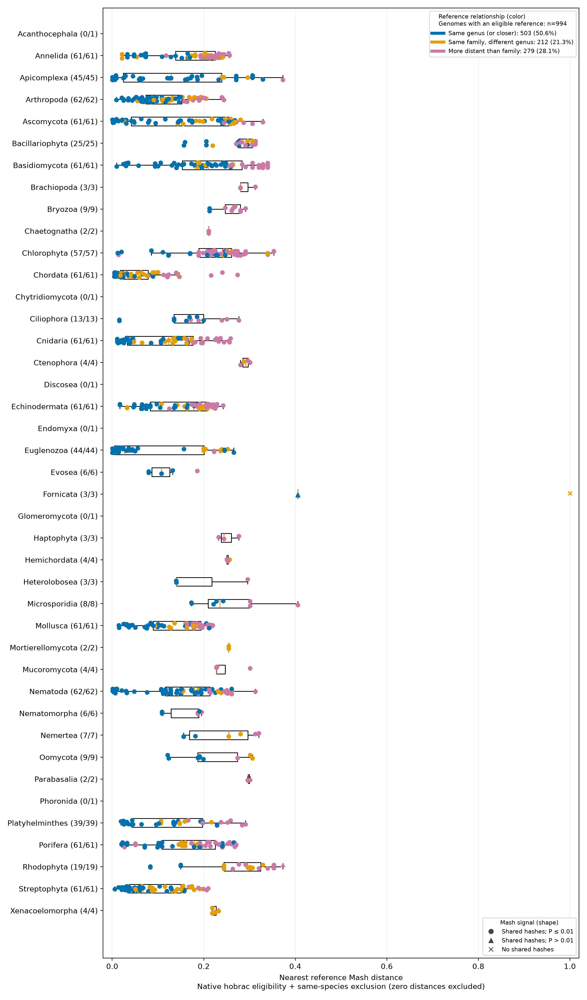

# Mash reference-availability survey

Samples species across the eukaryotic phyla Hobrac supports and uses Mash to find and measure each one's nearest eligible reference genome. The preparation step freezes the sample manifest and reference sketches; a Snakemake workflow then downloads, sketches, and reports.

```text
                    download A → Mash A ─┐
Frozen manifest ─── download B → Mash B ─┼─ report
                    download C → Mash C ─┘
```

**Archived run:** 1,000 species, 41 phyla, Mash 2.3, inputs frozen 22 September 2026. 994 queries had an eligible reference; 50.6% of those matched a same-genus reference. **Conclusion: broad availability of detectable sequence matches, with uneven reference proximity.** This does not demonstrate optimal reference selection.



[PDF version](report/outputs/distance_by_phylum.pdf). One point per query's nearest eligible reference from another species; lower distance = more similar. Color = taxonomic relationship, shape = Mash signal (see [Plot legend](#plot-legend)). Phylum labels show queries with an eligible reference / sampled.

## Key findings

**Sampling.** 9,942 eligible species (chromosome-level or complete assemblies, one assembly per species). All eligible species included in 30 phyla; 61–62 sampled from each of the 11 larger pools. All 1,000 queries completed with no failures.

**Taxonomic proximity** (994 queries with an eligible reference):

| Relationship to the selected reference | Genomes | Percentage |
| --- | ---: | ---: |
| Same genus | 503 | 50.6% |
| Same family, different genus | 212 | 21.3% |
| More distant than family | 279 | 28.1% |

**Mash signal** (994 pairs): 990 with P ≤ 0.01, 3 with P > 0.01, 1 with no shared hashes. All three sampled Fornicata were weak or absent: *Giardia duodenalis* and *Giardia muris* shared 1 of 10,000 hashes, *Spironucleus salmonicida* shared none. The other weak match was *Phymatolithon calcareum* (Rhodophyta), 2 of 10,000.

**Unevaluable queries.** Six phyla (Acanthocephala, Chytridiomycota, Discosea, Endomyxa, Glomeromycota, Phoronida) had a single eligible query species whose reference entries were all excluded by the same-taxid or zero-distance rules. Their `0/1` labels mean no eligible *alternative* under this survey's rules, not a database with only one assembly (Endomyxa had 2 entries, Glomeromycota 6). Hobrac can still use these species when another reference is supplied.

**Database size vs. same-genus rate.** Reference entries are comparison rows before exclusions; same-genus percentages use queries with an eligible reference as the denominator.

| Phylum | Reference entries | Queries with a reference | Same-genus matches | Median Mash distance |
| --- | ---: | ---: | ---: | ---: |
| Streptophyta | 4,362 | 61 | 36 (59.0%) | 0.067 |
| Chordata | 4,221 | 61 | 29 (47.5%) | 0.033 |
| Arthropoda | 3,894 | 62 | 35 (56.5%) | 0.110 |
| Ascomycota | 1,768 | 61 | 38 (62.3%) | 0.174 |
| Apicomplexa | 150 | 45 | 40 (88.9%) | 0.129 |
| Euglenozoa | 85 | 44 | 34 (77.3%) | 0.027 |
| Bacillariophyta | 19 | 25 | 8 (32.0%) | 0.291 |
| Rhodophyta | 17 | 19 | 4 (21.1%) | 0.296 |

Database size alone does not predict the same-genus rate. Euglenozoa has far fewer entries than Chordata but a higher rate, because 25 of its 44 queries are *Leishmania* and 6 are *Trypanosoma*; one-assembly-per-species sampling balances species, not genera. Within-phylum spread is also wide: Euglenozoa's interquartile range is 0.005–0.201 versus 0.018–0.078 for Chordata.

## Caveats

- Selection criterion is minimum Mash distance, a sequence-similarity proxy. The most sequence-similar genome is not necessarily the closest in chromosome structure or gene order; this survey does no downstream alignment or synteny validation.
- A small Mash P-value means the sketch overlap is unlikely under Mash's random-sequence model. It does not mean the reference is close enough for reliable whole-genome alignment. P-values are pairwise, not a test between phyla.
- A no-shared-hash distance of 1 is a placeholder, not a measured distance.
- Phyla with few sampled species should not be generalized.
- Results reflect one database snapshot. Future database growth may improve coverage; this run cannot measure that.

## Archive contents

```text
report/
├── inputs/
│   ├── eligible_species.tsv
│   ├── manifest.tsv
│   ├── phylum_coverage.tsv
│   ├── sampling_exclusions.json
│   └── snapshot.json
└── outputs/
    ├── nearest_references.tsv
    ├── phylum_summary.tsv
    ├── summary.json
    ├── distance_by_phylum.png
    ├── distance_by_phylum.pdf
    ├── retry_task_ids.txt
    └── reset_required_task_ids.txt
```

Start with the [sample manifest](report/inputs/manifest.tsv), [sampling coverage](report/inputs/phylum_coverage.tsv), and [per-query results](report/outputs/nearest_references.tsv).

- This is a report archive, not a runnable work directory: no reference sketches, taxonomy files, raw Mash comparisons, or execution logs. Paths in `snapshot.json` refer to the original work-directory layout.
- Inputs and provenance records are unchanged from the original run. Figures were regenerated from the per-query results with revised colors, shapes, and legend counts; script hashes in the provenance records identify the original run, not the plotting changes.
- The `inputs/`/`outputs/` split is an archive convention. A live run writes inputs under `$WORK/` and outputs under `$WORK/report/`.

# Running the workflow

## Requirements

Linux, Bash, Python ≥ 3.11, Hobrac and host-side Mash installed, Snakemake 9 with the Slurm executor plugin, matplotlib. To install the workflow dependencies into your Hobrac environment:

```bash
python3 -m pip install 'snakemake>=9,<10' snakemake-executor-plugin-slurm 'matplotlib>=3.6'
```

Copy this whole directory, including `scripts/` and `profiles/`.

## Quick start

```bash
cp config.example.sh config.local.sh   # 1. edit before submitting anything
bash submit.sh prepare                 # 2. freeze manifest + sketches; check $WORK/logs/
bash submit.sh workflow                # 3. run
```

After step 2, inspect `manifest.tsv`, `phylum_coverage.tsv`, and `sampling_exclusions.json` before proceeding. After step 3, results are under `$WORK/report/`.

## Configuration

Set in `config.local.sh`:

| Variable | Meaning |
| --- | --- |
| `WORK` | Absolute shared path; no spaces or shell metacharacters |
| `COUNT` | Sample size (default 1000) |
| `MAX_CONCURRENT` | Cap on submitted child jobs, including pending |
| `MASTER_TIME` | Runtime limit for the controller job |
| `TIME` | Runtime limit per Mash job |
| `CLEANUP` | `true` (default): delete FASTA files for successful queries; failed queries keep theirs |

Plus your environment and Slurm settings. **A different count, seed, scope, or reference snapshot requires a new `WORK` directory.** Cleanup never removes final results, mappings, logs, provenance, or shared reference data.

## Outputs

Under `$WORK/report/`:

- `distance_by_phylum.png` / `.pdf`: distance distributions by query phylum.
- `nearest_references.tsv`: every sampled query, including failures.
- `phylum_summary.tsv`, `summary.json`: counts and status summaries.

### Plot legend

- **Color** = nearest reference's relationship: blue same genus or closer, orange same family/different genus, reddish purple more distant than family.
- **Shape** = Mash signal: circle P ≤ 0.01, triangle P > 0.01, cross no shared hashes (distance 1 placeholder, keeps its relationship color).
- Legend counts and percentages are over all queries with an eligible reference, including weak and no-hash matches; failed, incomplete, and no-eligible-reference queries are excluded. The legend title states the denominator.
- Boxplots include only queries with shared hashes.
- Display choices do not affect reference selection or reported statistics.

## Restart or inspect

```bash
bash submit.sh workflow                            # continue unfinished work
bash submit.sh summarize                           # partial report
bash workflow.sh config.local.sh --dry-run
bash workflow.sh config.local.sh --executor local --cores 8   # run without Slurm
```

- Snakemake reuses completed queries, even after their FASTA files were cleaned up.
- Never run two controllers against the same `WORK`.
- If the controller timed out or was killed, confirm all child jobs have finished or been cancelled before restarting.
- Clear a stale lock only after confirming nothing is still writing to `WORK`.

## Directory layout

| Path | Purpose |
| --- | --- |
| `config.example.sh` | Template configuration to copy and edit |
| `submit.sh` | Submits preparation, controller, or reporting jobs to Slurm |
| `workflow.sh`, `Snakefile` | Launches the Snakemake controller and defines the DAG |
| `profiles/` | Default scheduler profiles |
| `scripts/` | Python backend and Slurm job entry point |
| `tests/` | Offline unit tests and local workflow integration tests |
| `report/inputs/` | Archived sampling inputs and snapshot provenance |
| `report/outputs/` | Archived result tables, figures, and status summaries |

## Tests

```bash
python3 -m unittest discover -s tests -t .. -v
```

Fully offline (mock Hobrac/Mash, loopback FASTA server; no Slurm, no NCBI). Covers step overlap, temporary-file cleanup, restarts, failure handling, migration, and a 1,000-genome DAG dry run.
